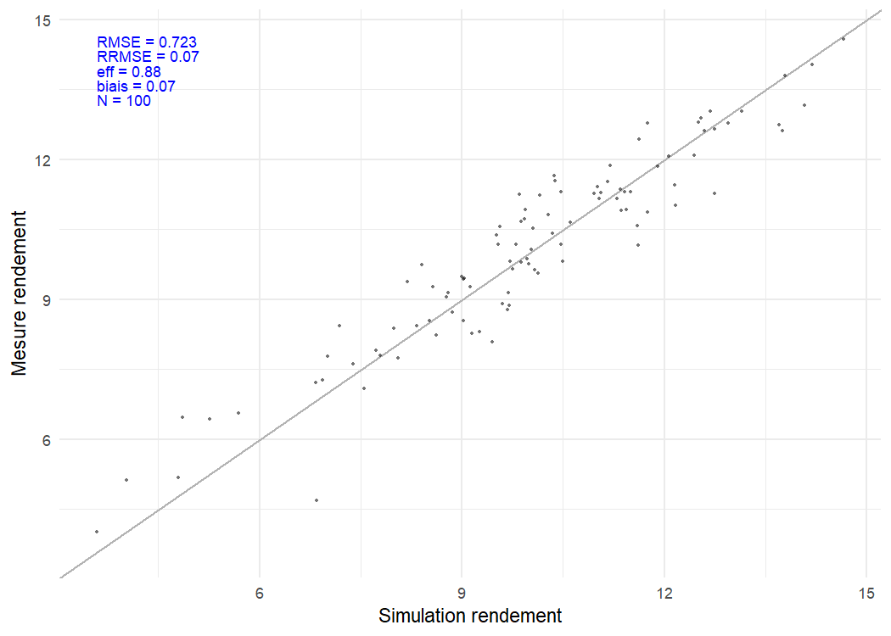
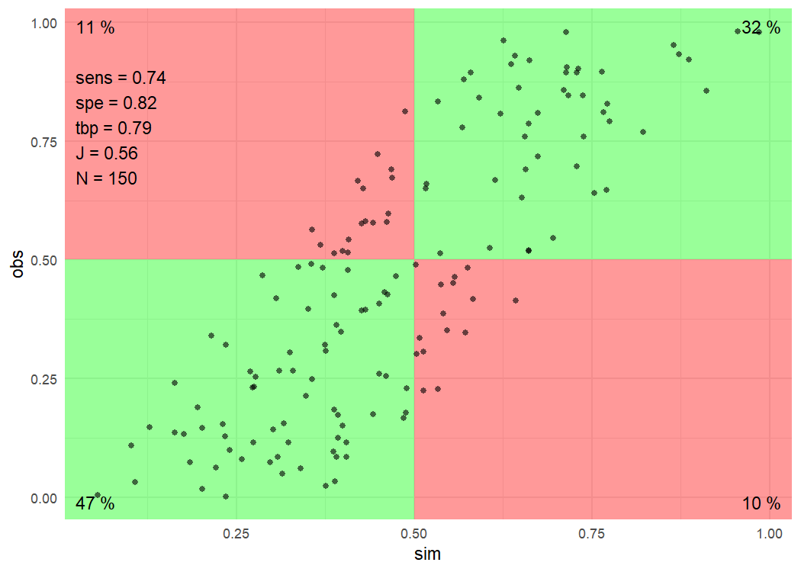
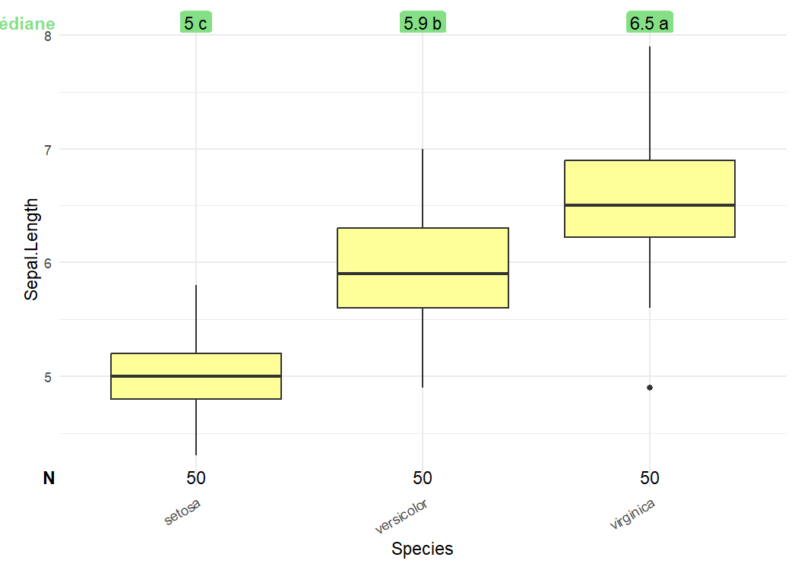
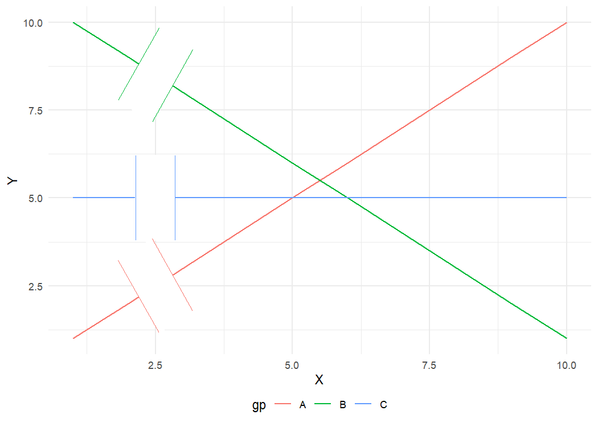
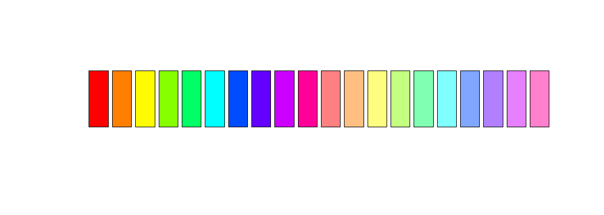
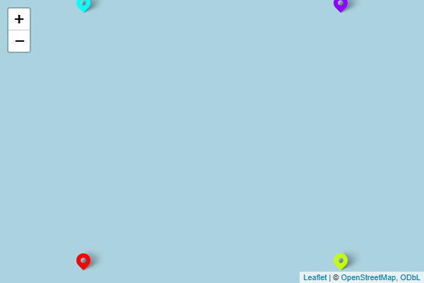
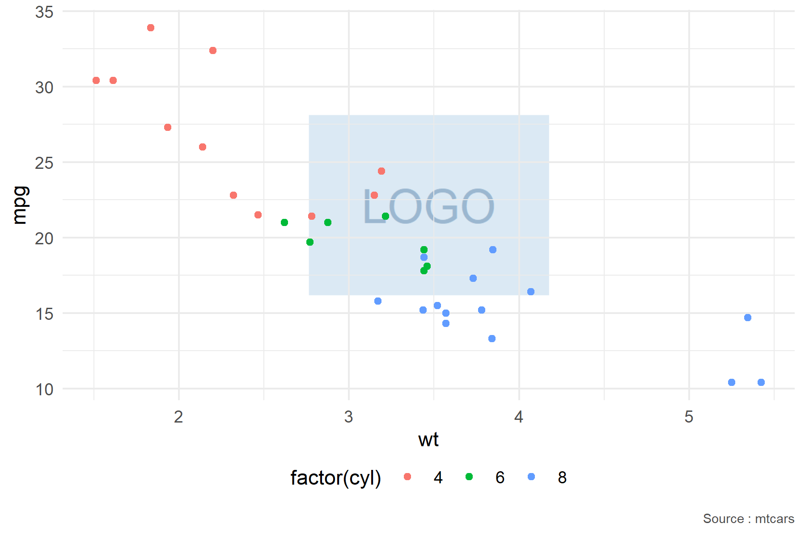
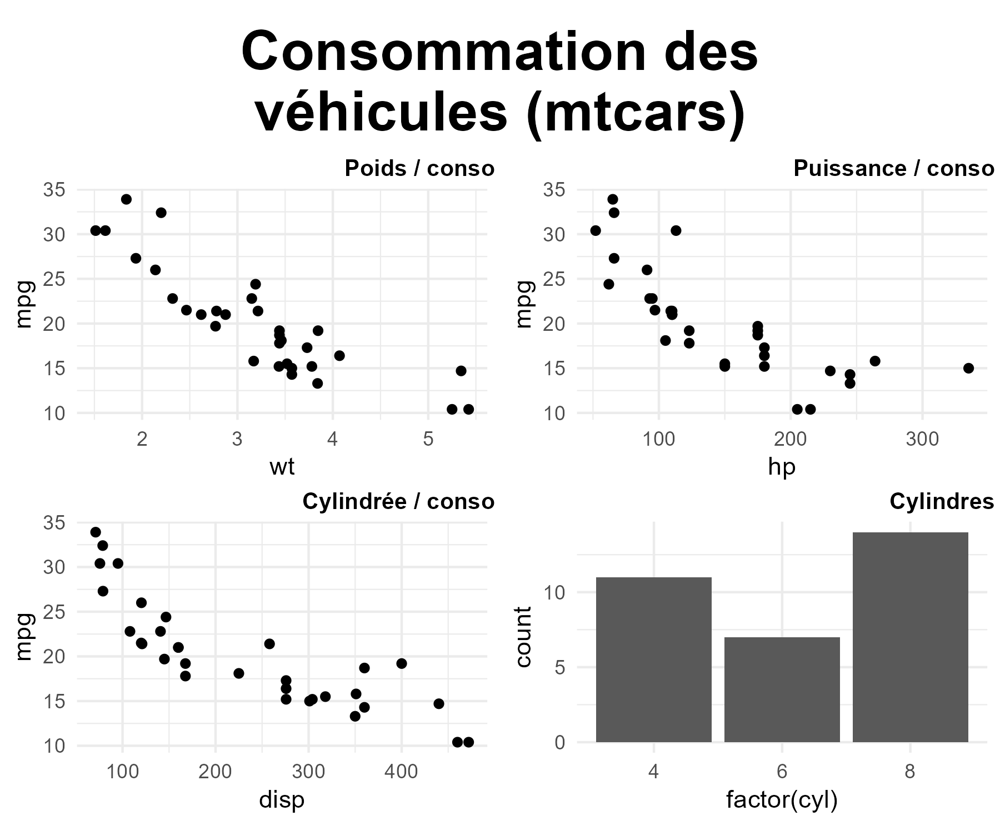

<!-- README.md est généré à partir de README.Rmd. Modifier README.Rmd uniquement,
     puis lancer : devtools::build_readme() -->

# pack.figures

<!-- badges: start -->


<!-- badges: end -->

Package R regroupant des fonctions pour les **graphiques** (ggplot2) et
la **cartographie** (Leaflet) : graphiques préconfigurés, mise en forme
et export de figures, palettes de couleurs, etc.

## Installation

``` r
# install.packages("remotes")
remotes::install_github("Amaury974/pack.figures")
```

Le package dépend de
[`pack.divers`](https://github.com/Amaury974/pack.divers) (déclaré dans
`Remotes`), installé automatiquement.

### Packages optionnels

Certaines fonctions nécessitent des packages supplémentaires, vérifiés à
l’appel :

| Package            | Utilisé par                                |
|--------------------|--------------------------------------------|
| `cowplot`          | `fig_grid()`, `rf_fig()`                   |
| `agricolae`        | `boxplot2()`                               |
| `colorspace`       | `mega_Palette()`                           |
| `sf`, `sp`, `maps` | `quel_dep()`                               |
| `leaflet`          | `leaf_colored_markers()`                   |
| `randomForest`     | `rf_fig()`                                 |
| `magick`           | `add_background_image()`, `save_plot_bg()` |

``` r
install.packages(c("cowplot", "agricolae", "colorspace", "sf", "sp", "maps",
                   "leaflet", "randomForest", "magick"))
```

## ⚠️ Options ggplot2 modifiées au chargement

Au chargement (`library(pack.figures)`), le package modifie le thème
global de ggplot2 :

- thème `theme_minimal()` par défaut ;
- légende en bas, disposée horizontalement ;
- titre aligné à gauche, sous-titre et légende (`caption`) en gris ;
- palette continue `viridis` pour `colour` et `fill`.

Il règle aussi `dplyr.summarise.inform = FALSE` (messages de
`summarise()` masqués).

Pour désactiver ces réglages, **avant** de charger le package :

``` r
options(ggplot.change.default.options = FALSE,
        dplyr.change.default.options  = FALSE)
library(pack.figures)
```

## Fonctions

### Graphiques préconfigurés

| Fonction | Description |
|----|----|
| `graph_perf()` | Graphique observé / simulé avec indicateurs de performance (RMSE, RRMSE, biais, efficience, ou MAPE si effet développement) |
| `graph_perf_ROC()` | Graphique observé / simulé en quadrants selon des seuils, avec sensibilité, spécificité, taux de bien prédits et indice de Youden |
| `boxplot2()` | Boxplot par catégorie avec test de Tukey (groupes de significativité), classé par médiane |
| `rf_fig()` | Figure d’analyse d’une forêt aléatoire : %IncMSE et IncNodePurity |
| `geom_break()` | Ajoute une cassure sur une courbe pour indiquer une rupture de continuité |

### Mise en page et export

| Fonction | Description |
|----|----|
| `fig_grid()` | Assemble plusieurs graphiques en grille (titre, noms de lignes/colonnes, légende commune) et l’enregistre |
| `sauv_graph()` | Enregistre une figure en png et/ou svg |
| `add_background_image()` | Ajoute une image en arrière-plan (non déformée) sous le quadrillage d’un ggplot |
| `save_plot_bg()` | Enregistre un ggplot avec image de fond (png) |
| `dim_aire()` | Dimensions d’export optimales pour un ratio et une aire donnés |
| `quelles_marges()` | Marges fixes (X, Y) d’un ggplot |

### Couleurs

| Fonction | Description |
|----|----|
| `mega_Palette()` | Palette jusqu’à ~50 couleurs à peu près discernables (non adaptée aux daltoniens) |

### Cartographie

| Fonction | Description |
|----|----|
| `quel_dep()` | Identifie le département à partir de coordonnées (colonnes longitude/latitude) ; renvoie les données enrichies et les centroïdes des départements |
| `leaf_colored_markers()` | Crée une liste de marqueurs colorés pour Leaflet (`leaflet::iconList()`) |

La documentation détaillée de chaque fonction est accessible via
`?nom_de_la_fonction`.

## Exemples

``` r
library(pack.figures)
#> Le chargement a nécessité le package : ggplot2
#> Warning: le package 'ggplot2' a été compilé avec la version R 4.4.3
```

### Performance observé / simulé

``` r
df <- data.frame(mesure = rnorm(100, 10, 2))
df$modele <- df$mesure + rnorm(100, 0, 0.8)

graph_perf(df, obs = "mesure", sim = "modele", .variable = "rendement")
```



### Performance de type ROC

``` r
df_roc <- data.frame(obs = runif(150), sim = runif(150))
df_roc$sim <- 0.6 * df_roc$obs + 0.4 * df_roc$sim

graph_perf_ROC(df_roc, obs = "obs", sim = "sim", seuil_obs = 0.5, seuil_sim = 0.5)
```



### Boxplot avec test de Tukey

``` r
boxplot2(iris, x = "Species", y = "Sepal.Length")
```



### Cassure de courbe

``` r
test <- data.frame(X  = c(1:10, 1:10, 1:10),
                   Y  = c(1:10, 10:1, rep(5, 10)),
                   gp = c(rep("A", 10), rep("B", 10), rep("C", 10)))
test$bk <- test$X %in% c(2, 3)

graph_test <- ggplot(test, aes(X, Y, color = gp)) +
  geom_line()

geom_break(graph = graph_test,
           data = test,
           X = "X", Y = "Y",
           groupe = "gp",   # une cassure par courbe
           filtre = "bk",   # points entre lesquels placer la cassure
           ratio_X_Y = 1.5, size = 2)
```



### Palette étendue

``` r
N_col <- 20
barplot(rep(1, N_col), col = mega_Palette(N_col), axes = FALSE)
```



### Marqueurs Leaflet colorés

``` r
list_col <- list(rouge  = "#FF0000",
                 vert   = "#C5FF00",
                 bleu   = "#00FFFF",
                 violet = "#9100FF")

my_markers <- leaf_colored_markers(list_col)

leaflet::leaflet() |>
  leaflet::addTiles() |>
  leaflet::addMarkers(lat = c(0, 0, 1, 1),
                      lng = c(0, 1, 0, 1),
                      icon = my_markers[names(list_col)])
```

    #> file:///C:/Users/Delagarde/AppData/Local/Temp/RtmpMNiNqX/file4e601f5d6b09.html screenshot completed



### Département à partir de coordonnées

``` r
villes <- data.frame(ville     = c("Paris", "Lyon", "Marseille"),
                     longitude = c(2.35, 4.83, 5.37),
                     latitude  = c(48.85, 45.76, 43.30))

res <- quel_dep(villes)
#> Warning in CPL_crs_from_input(x): GDAL Message 1: +init=epsg:XXXX syntax is
#> deprecated. It might return a CRS with a non-EPSG compliant axis order.
res$data
#>       ville longitude latitude    x     y      departement
#> 1     Paris      2.35    48.85 2.35 48.85            Paris
#> 2      Lyon      4.83    45.76 4.83 45.76            Rhone
#> 3 Marseille      5.37    43.30 5.37 43.30 Bouches-du-Rhone
head(res$centroides)
#>      departement      lat     long
#> 1           Nord 3.222770 50.44435
#> 2  Pas-de-Calais 2.303386 50.49645
#> 3          Somme 2.280143 49.96838
#> 4       Ardennes 4.648482 49.61451
#> 5 Seine-Maritime 1.027710 49.65798
#> 6          Aisne 3.567181 49.56785
```

### Image de fond et export

``` r
p <- ggplot(mtcars, aes(wt, mpg, color = factor(cyl))) +
  geom_point() +
  labs(caption = "Source : mtcars")

# image de fond générée pour l'exemple
img <- tempfile(fileext = ".png")
png(img, width = 400, height = 300)
par(mar = c(0, 0, 0, 0)); plot.new()
rect(0, 0, 1, 1, col = "#dbe9f4", border = NA)
text(0.5, 0.5, "LOGO", cex = 6, col = "#9bb7d0")
invisible(dev.off())

save_plot_bg(p, "man/figures/README-plot-bg.png", image_path = img,
             width = 6, height = 4)

```


### Marges et dimensions d’export

``` r
marges <- quelles_marges(p)
marges
#> $marge_X
#> [1] 0.551363
#> 
#> $marge_Y
#> [1] 1.099312

# dimensions d'export pour un graphique de ratio 4/3 et une aire totale de 30 in²
dim_aire(ratio = 4/3, aire = 30,
         marge_X = marges$marge_X, marge_Y = marges$marge_Y)
#> $X
#> [1] 5.033672
#> 
#> $Y
#> [1] 4.874566
```

### Export png / svg

``` r
dossier <- tempdir()

sauv_graph(p, file.path(dossier, "ma_figure"), width = 6, height = 4, .silence = TRUE)
list.files(dossier, pattern = "^ma_figure")
#> [1] "ma_figure.png" "ma_figure.svg"
```

### Grille de figures

``` r
liste_graph <- list(
  "Poids / conso"   = ggplot(mtcars, aes(wt, mpg))  + geom_point(),
  "Puissance / conso" = ggplot(mtcars, aes(hp, mpg)) + geom_point(),
  "Cylindrée / conso" = ggplot(mtcars, aes(disp, mpg)) + geom_point(),
  "Cylindres"       = ggplot(mtcars, aes(factor(cyl))) + geom_bar()
)

fig_grid(liste_graph,
         titre   = "Consommation des véhicules (mtcars)",
         fichier = "man/figures/README-fig-grid.png",
         ncol    = 2)


```


### Figure d’analyse d’une forêt aléatoire

``` r
rf <- randomForest::randomForest(Sepal.Length ~ ., data = iris, importance = TRUE)

rf_fig(rf, titre = "Importance des variables",
       fichier = "man/figures/README-rf-fig.png")
```

## Licence

Distribué sous licence [GNU GPL (≥ 3)](LICENSE.md).

## Auteur

Amaury Jorant ([@Amaury974](https://github.com/Amaury974)) —
[issues](https://github.com/Amaury974/pack.figures/issues)
